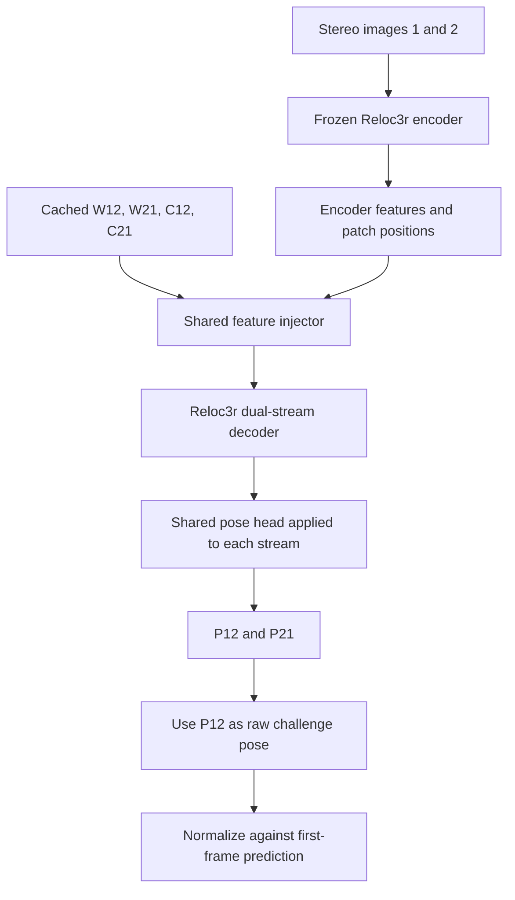

# Relative Pose Regression iMED challenge

**iMED Challenge 2026 winning method — reported ATE RMSE: 2.193 mm.**

Relative pose regression with a frozen Reloc3r image encoder and RoMaV2 correspondences. Correspondences guide a learned residual update to encoder **features**, before the Reloc3r decoder. Positional indices remain unchanged.

This repository organizes `train_reloc3r_romav2_feature_inject_v1.py` from the original research workspace into modules. The original experiment script is preserved in that workspace. This is a code release; datasets, correspondence caches, pretrained weights, and experiment checkpoints are external.

## Challenge result

| Challenge | Reported placement | ATE RMSE |
|---|---|---|
| iMED Challenge 2026 | Winner | **2.193 mm** |

The method uses RoMaV2 correspondences to sample matched features between the two images, gates learned feature updates by match confidence, and regresses relative pose through the Reloc3r decoder and a shared pose head. The challenge result and placement were supplied by the project author; the validation checks in this release cover code execution and refactor correctness, rather than reproduction of the challenge score. See [provenance](docs/provenance.md).

## Repository layout

```text
roma_pose/
  models/
    feature_injection.py   # bidirectional correspondence-guided feature update
    pose_head.py           # pooled decoder features -> rotation and translation
    reloc_roma.py          # frozen encoder + injection + decoder + shared head
  data/
    samples.py             # sequence/frame enumeration and ground-truth poses
    dataset.py             # first/current images, cached warps, batch collation
  evaluation/              # local iMED pose metrics, alignment and pose I/O
  utils/                   # SE(3), losses, parameter and gradient utilities
  engine.py                # checkpoint I/O, training, evaluation, sanity check
  cli.py                   # command-line arguments
configs/                   # documented experiment arguments
docs/                      # architecture, data conventions and provenance
scripts/                   # forward-only debugging entry point
tests/                     # numerical refactor and geometry checks
third_party/               # external source checkouts, excluded from Git
```

## Setup

Use Python 3.10 or newer. Install a compatible PyTorch/torchvision pair for your machine, then install this project:

```powershell
python -m pip install -e .
```

Reloc3r is an external dependency. The source checkout used in the original workspace is the `ffrivera0/reloc3r` fork at commit `761fac648e9c21fd7dcda01ab2ccd4fc20058102`. Its CroCo submodule and any required positional-embedding extensions must also be available. See [dependencies](docs/dependencies.md).

For the existing local workspace, use the already available checkout:

```powershell
$env:RELOC3R_ROOT = "D:/MICCAI_PE/.reloc3r_src"
```

On a new machine, place the required source checkout at `third_party/reloc3r`, or set `RELOC3R_ROOT` to its location. The default Reloc3r weights are `siyan824/reloc3r-512`; the first model construction can download these weights.

## Run in the existing workspace

From `D:/MICCAI_PE/roma_feature_injection`, with the environment above set, run a **forward-only** pass:

```powershell
python scripts/forward_once.py --data-root ../data --roma-cache-root ../outputs/roma_cache --num-workers 0
```

This loads one batch and predicts the first and current stereo pairs under `torch.no_grad()`. There is no backward pass or optimizer update. The normalized trajectory prediction is `inverse(C_0) @ C_t`, so one batch involves two stereo-pair model calls.

Run the original **forward + backward sanity check**:

```powershell
python -m roma_pose --data-root ../data --roma-cache-root ../outputs/roma_cache --num-workers 0
```

The sanity check reports tensor shapes, losses, frozen parameters, and gradient norms. It does not run a training epoch. Its inherited shape assertions assume 512-size inputs, 800 decoder tokens, and 9D rotation output.

Train for ten epochs:

```powershell
python -m roma_pose --train --data-root ../data --roma-cache-root ../outputs/roma_cache --output-dir outputs/train_only_e10 --epochs 10 --batch-size 4 --lr 2e-5 --decoder-lr 5e-6 --eval-every 1
```

Commands above are single lines; PowerShell continuation characters are unnecessary. `python -m roma_pose --help` lists all options. Cache mode is the default. Online matching requires an additional RoMaV2 installation and `--online-roma`.

## Method



- `W12` / `W21`: dense target `(x, y)` coordinate maps, shape `[B,H,W,2]`, in normalized image coordinates.
- `C12` / `C21`: match confidence maps, shape `[B,1,H,W]`.
- The injector samples the opposite image's features at matched locations and combines feature and geometry hints.
- The encoder and RoMaV2 are frozen. The injector, decoder and wrapped pose head train by default; `--freeze-decoder` also freezes the decoder.
- The head predicts three translation values and nine rotation values (six for a configured 6D base head), then constructs a valid rotation matrix and a homogeneous pose.

See [architecture](docs/architecture.md), [data and cache format](docs/data.md), and [experiment provenance](docs/provenance.md) for exact behavior and limitations.

## Validation

```powershell
python -m unittest discover -s tests -v
```

Unit checks cover coordinate sampling, confidence gating, zero-initialized residual gradients and SE(3) normalization. A full dataset sanity run additionally requires external Reloc3r sources, weights, images and cache files. Historical metrics are not presented as validation of this refactor.

## Upload

Only this directory is the release repository. Its `.gitignore` excludes images, caches, checkpoints, local environments and external source checkouts. See [publishing](docs/publishing.md) for the GitHub push commands.
